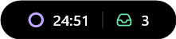
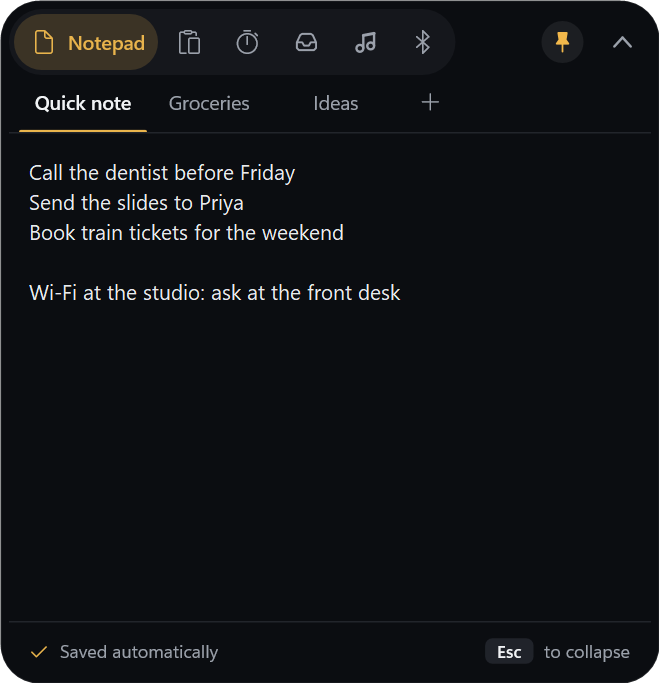
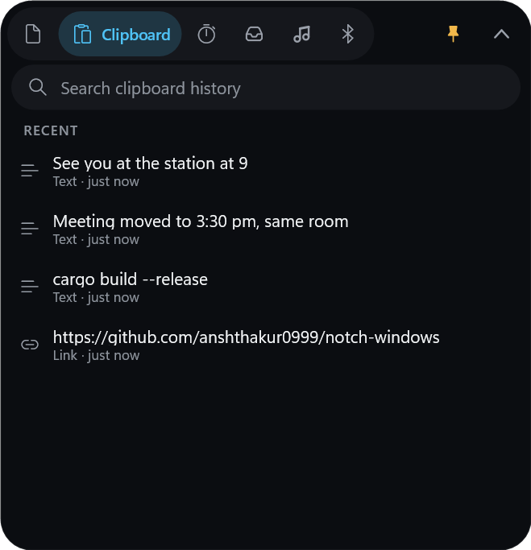
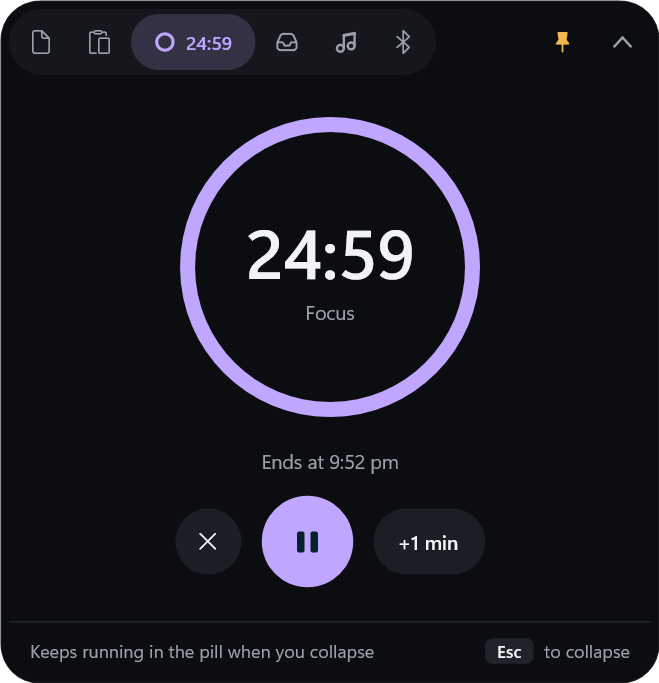
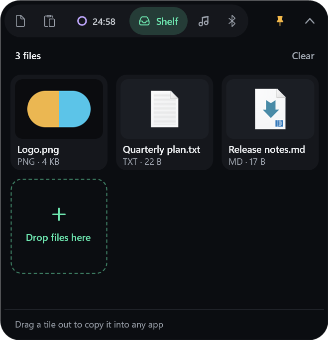
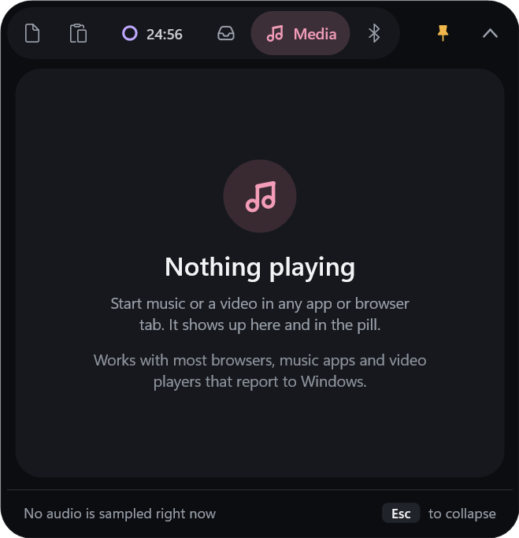
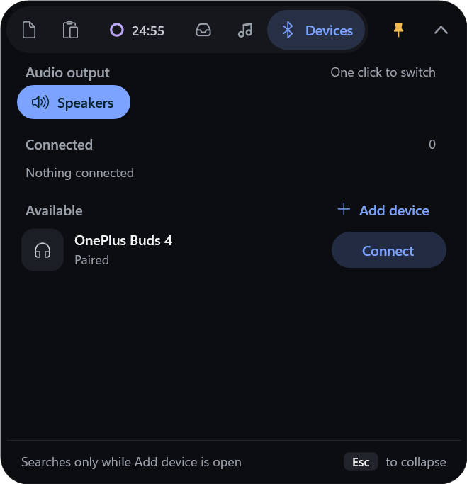

<p align="center">
  
</p>

# Notch

[](https://github.com/anshthakur0999/notch-windows/releases/latest)

A small floating pill at the top of your screen, like a Dynamic Island for Windows. Hover it and it
opens; move away and it closes. Inside are six tools:

* **Notepad**: quick notes as tabs, saved as you type.
* **Clipboard**: a searchable history of what you copied; click an entry to paste it.
* **Timer**: type `25m` and go; it rings when time is up.
* **Shelf**: drop files on the pill now, drag them into any app later.
* **Media**: what's playing in your browser or music app, with play / pause, skip and seek.
* **Devices**: battery levels of your Bluetooth earbuds, mouse and controller, and one-click
  audio switching.

It is one small exe with no installer, and it uses next to no CPU while you're not touching it.

<p align="center">
  
</p>

| | | |
| :---: | :---: | :---: |
|  |  |  |
| **Notepad** | **Clipboard** | **Timer** |
|  |  |  |
| **Shelf** | **Media** | **Devices** |

## Install

1. Download `notch.exe` from the [latest release](https://github.com/anshthakur0999/notch-windows/releases/latest)
   and run it. The pill appears at the top of your screen and an icon is added to the tray.
2. Optional: right-click the tray icon and tick **Start with Windows**.

Needs Windows 10 or 11 (64-bit). The exe isn't code-signed, so SmartScreen may ask you to confirm the
first time. To check your download, compare `certutil -hashfile notch.exe SHA256` with the
`notch.exe.sha256` file on the release page.

**Uninstall:** untick **Start with Windows**, choose **Quit** from the tray menu, then delete
`notch.exe` and the folder `%APPDATA%\Notch`.

## Quick start

| To | Do this |
| --- | --- |
| Open the pill | Hover it, click it, or press `Win+Alt+N` |
| Open the clipboard | `Win+Alt+V`, then just start typing to search |
| Switch tools | Click a tab in the header, or press `Tab` |
| Keep it open | Click the pin in the header |
| Close it | Move the mouse away, press `Esc`, or click another app |
| Hide / show the pill | `Win+Alt+H`, or the tray menu |

If another app already uses a hotkey, Notch uses `Ctrl+Alt+N` / `Ctrl+Alt+V` / `Ctrl+Alt+H` instead.
Hover the tray icon to see which ones are active.

## Notepad

* **`+`** or `Ctrl+N` adds a note; `Ctrl+Tab` / `Ctrl+Shift+Tab` moves between them (up to 30).
* **Double-click** a tab to rename it. Delete a note with the **x** on its tab, a middle-click,
  `Ctrl+W` or the right-click menu. A note with text asks before it goes.
* The first note, **Quick note**, is always there: you can rename and clear it, but not delete it.
* Everything saves automatically a second after you stop typing.

## Clipboard

* Click an entry to paste it into the app you were in. Hold `Shift` while clicking to only copy it.
* Type to search. `Esc` clears the search, and a second `Esc` closes the pill.
* Hover an entry to **pin** it (pinned entries are kept forever) or remove it with **✕**.
* Text, links, code and images are all kept. Passwords copied from a password manager are never
  recorded. You can pause recording from the tray menu.
* Each time you copy, the pill briefly widens to say **Copied** and shows what it was. Click it to
  open the pill.

## Timer

* Type a time such as `25m`, `1h 30m`, `90s` or just `10` (minutes), or tap a preset, then press
  `Enter` or **Start**. You can add a label. One timer at a time, up to 24 hours.
* While it runs you can pause it, stop it or add a minute. Close the pill and the time left stays
  on the pill.
* **When time is up** the pill glows and Windows' alarm sound rings until you press **Done** or
  **+5 min**. If the pill is hidden, you also get a Windows notification. To change the sound, pick
  another one for "Alarm 1" in Windows' Sound settings (Sounds tab), or choose None to silence it.
* The timer isn't saved: quitting Notch ends it, and time the PC spends asleep isn't counted.

## Shelf

A place to park files while you work.

* **Add files** by dropping them on the pill, or with the **+** tile. It holds up to 48.
* **Drag them out** into any app. Click tiles to tick several and drag them together. Dropping
  always copies, so the originals stay where they are.
* **Remove** a file with the **x** on its tile, or `Del` for the ticked ones; **Clear** empties the
  shelf. Nothing is ever deleted from your disk.
* The shelf keeps links, not copies. If you move or delete a file, its tile says **Missing**.
* Files leave the shelf after 24 hours (change it with `shelf_hours` in [Settings](#settings)).
* Things you can't add: images dragged straight out of a browser, and files dragged from an app
  running as administrator.

## Media

Works with anything that shows up in Windows' own media controls: Chrome, Edge, Firefox, Spotify,
the Windows media apps and most others. There's nothing to set up.

* The closed pill shows the cover of what's playing. When the track changes it briefly shows the
  title and artist.
* The **Media** tab has play / pause, previous / next and a seek bar: click it, or drag it to scrub.
* Buttons the player doesn't support are greyed out, for example next / previous on a single
  YouTube video.
* **Bars** turns the visualizer on or off. It reacts to what your speakers play (never the
  microphone), only while it's on screen, and nothing is recorded.

## Devices

For Bluetooth earbuds, headphones, mice, keyboards and game controllers that are already paired
with Windows.

* **When a device connects** the pill shows a card with its battery level. Earbuds also get **Use
  for audio**, which moves your sound to them. A **Battery low** card appears at 20% and 10%.
* The **Devices** tab lists:
  * **Audio output**: click one to send all sound there.
  * **Connected**: each device with its battery and **Disconnect**.
  * **Available**: paired devices that aren't connected, with **Connect**. A connect takes about
    6 to 12 seconds.
* **Add device** searches for nearby devices and pairs the one you pick. Phones, and devices that
  need a PIN typed in, are paired from Windows' Bluetooth settings instead.
* `"device_banner": false` in [Settings](#settings) turns the pop-up cards off; the tab still works.

Good to know:

* The battery level is what Windows reports, the same number as in Windows Settings. Some earbuds
  report the case rather than the buds. Mice on a USB receiver (Logitech Unifying or Bolt) and
  PlayStation controllers show **Battery unknown**.
* Devices on USB, or on a non-Bluetooth wireless adapter, don't appear.
* Bluetooth LE devices, such as many newer mice, are connected by Windows itself, so they have no
  Connect button.
* Audio switching uses a part of Windows that Microsoft doesn't document, so a Windows update could
  break it. The rest of Notch would keep working.

## Tray menu

Right-click the tray icon for: Open, Hide / Show pill, **Theme** (Dark, Light or Match Windows),
**Accent colour**, **Text size** (for notes and clipboard entries), **Monitor** (which screen the
pill sits on), Pause clipboard capture, Start with Windows, and Quit. Changes apply straight away.

The pill hides itself while a full-screen app or game is in front, and comes back when you leave
it.

## Command line

While Notch is running you can control it from a terminal, shortcut or script:

```
notch.exe hide       hide the pill
notch.exe show       bring it back
notch.exe toggle     hide or show it
notch.exe quit       close Notch
notch.exe --hidden   start Notch with the pill hidden
notch.exe help       list the commands
```

While the pill is hidden, Notch still records your clipboard, but the open hotkeys do nothing.

## Settings

Most people never need this. The tray menu covers the look; everything else lives in
`%APPDATA%\Notch\settings.json`. Every key is optional. Restart Notch after editing.

| Key | Default | What it does |
| --- | --- | --- |
| `hotkey_toggle` | `"Win+Alt+N"` | Opens / closes the pill |
| `hotkey_clipboard` | `"Win+Alt+V"` | Opens the clipboard |
| `hotkey_visibility` | `"Win+Alt+H"` | Hides / shows the pill |
| `hover_dwell_ms` | `120` | How long to hover before the pill opens |
| `collapse_delay_ms` | `100` | How long after the mouse leaves before it closes |
| `max_items` | `200` | Clipboard entries kept (pinned ones don't count) |
| `max_image_mb` | `200` | Disk space for clipboard images |
| `paste_on_click` | `true` | Clicking a clipboard entry also pastes it |
| `copy_peek` | `true` | Show the "Copied" pop-up |
| `copy_peek_preview` | `true` | Show what was copied in it (`false` shows only "Copied") |
| `copy_peek_ms` | `2000` | How long the "Copied" pop-up stays |
| `device_banner` | `true` | Bluetooth connect, disconnect and low-battery cards |
| `shelf_hours` | `24` | How long files stay on the shelf (`0` = until removed) |
| `visualizer` | `true` | The moving bars for music |
| `theme` | `"dark"` | `dark`, `light` or `system` |
| `accent` | `"classic"` | `classic`, `sky`, `amber`, `mint`, `violet` or `rose` |
| `text_size` | `"medium"` | `small`, `medium` or `large` |
| `monitor` | `""` | A display name such as `\\.\DISPLAY2` (empty = the main display) |
| `use_gpu` | `false` | Draw with the graphics card (uses about 55 MB more memory) |

Hotkeys are written like `Win+Alt+N` or `Ctrl+Alt+F9`.

## Your data

Everything stays on your PC in `%APPDATA%\Notch`: your notes, clipboard history, shelf and
settings. Nothing is sent anywhere. To start fresh, quit Notch and delete that folder.

## Build from source

You need Rust 1.85 or newer (MSVC toolchain) and the Visual Studio C++ Build Tools.

```
cargo test
cargo build --release      # creates target\release\notch.exe
```

Set `NOTCH_LOG=1` before starting Notch to write a debug log to `%TEMP%\notch.log`.
